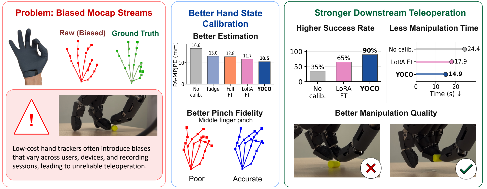

# YOCO: You Only Calibrate Once!

**Fast Mocap Calibration for Dexterous Teleoperation, CoRL 2026**

Yu Zhang, Yunqi Li, Yushi Du, Yi Ma, Yanchao Yang

[Paper](https://arxiv.org/abs/2610.11657) | [Website](https://franklin-zhang0.github.io/YOCO/) | [Hugging Face](https://huggingface.co/collections/Franklin0/yoco-6acf4f2f1580be300065ce25)

YOCO calibrates a hand-pose estimator from just four paired poses. A hypernetwork
generates session-specific LoRA updates in one forward pass, without test-time
fine-tuning. This release includes pretrained models, a Python inference API,
and evaluation scripts for the paper's offline experiments.



## Setup

Install [uv](https://docs.astral.sh/uv/getting-started/installation/), then:

```bash
git clone --branch release/yoco-website https://github.com/Franklin-Zhang0/YOCO.git
cd YOCO
uv sync --frozen --extra cpu
```

The lockfile manages Python 3.10, PyTorch, and the MANO dependencies. The reference
environment is Linux x86_64. For CUDA 12.4, use `--extra cu124` instead of
`--extra cpu` in both setup and subsequent `uv run` commands.
See [INSTALL.md](INSTALL.md) for environment details.

Obtain `MANO_LEFT.pkl` and `MANO_RIGHT.pkl` separately under the
[MANO license](https://mano.is.tue.mpg.de/license.html), and point to their directory:

```bash
export MANO_PATH=/absolute/path/to/mano_models
```

Offline inference does not require ROS or a robot URDF. The repository is named
YOCO; its Python package remains `calibration_net`.

## Pretrained Models

One YOCO checkpoint serves both evaluation tables, with a frozen estimator for
canonicalization and baseline initialization.

| Model | Calibration Pairs | LoRA Rank | Download |
| --- | ---: | ---: | --- |
| YOCO, depth 4 | 4 | 32 | [Model bundle](https://huggingface.co/Franklin0/YOCO/tree/main/yoco) |
| Frozen estimator / canonicalizer | - | - | [Model bundle](https://huggingface.co/Franklin0/YOCO/tree/main/frozen_estimator) |

The model bundles and
[prepared evaluation data](https://huggingface.co/datasets/Franklin0/YOCO-Reproduction)
are publicly downloadable. The
[collection](https://huggingface.co/collections/Franklin0/yoco-6acf4f2f1580be300065ce25)
is **private for now**.

```bash
uv run --frozen --extra cpu python scripts/download_reproduction_assets.py --models-only
```

Authentication is optional; set `HF_TOKEN` for authenticated Hub requests.
The downloader pins immutable revisions and verifies file sizes and SHA256
hashes. Remove `--models-only` to include the evaluation data.
MANO files are not included. Only load trusted checkpoints.

## Use YOCO

Load the model, calibrate once for your session, then predict new poses:

```python
from calibration_net.yoco import YOCO

model = YOCO.from_pretrained(
    "assets/models/yoco",
    canonicalizer_dir="assets/models/frozen_estimator",
    side="right",
    device="cpu",
)
model.calibrate(raw_pairs, target_pairs)
result = model.predict(raw_frames)
theta, joints = result.theta, result.joints
```

`raw_pairs` and `target_pairs` are paired `(4, 21, 3)` arrays in meters, using
MANO joint order. `raw_frames` is `(21, 3)` or `(N, 21, 3)`.
Outputs are MANO pose angles in radians and wrist-local, palm-aligned joints
in meters. Calling `calibrate` again starts an independent session.

For an NPZ file containing those three arrays:

```bash
uv run --frozen --extra cpu python scripts/run_yoco.py --input observations.npz --output predictions.npz
```

See [the inference guide](docs/inference.md) for input conventions, MANO shape
parameters, and a runnable example using the released AVP recording.

## Paper Reproduction

The entrypoint is [`scripts/reproduce_paper.py`](scripts/reproduce_paper.py).
It runs the selected tables and methods over seeds 0, 1, and 2, then verifies
the saved predictions. Setup, datasets, options, and metric definitions are in
the [reproduction guide](reproduction/README.md).

**Paper correction:** "Tip-PA" in the main paper is a typo. It should be
**`tip_mpjpe_mm`**, the unaligned fingertip MPJPE in millimeters.

The default CPU run verifies YOCO's release reference values, including
Table 2's rounded MPJPE, **not its full original row**. Baselines use the paper's
accuracy references. Hardware timings are outside the accuracy check.

## License

Prepared InterHand data retains the upstream
[CC-BY-NC 4.0 terms and attribution](https://github.com/facebookresearch/InterHand2.6M/blob/main/LICENSE).
MANO has a separate license. See the Hugging Face cards for asset-specific terms.

## Citation

```bibtex
@inproceedings{zhang2026yoco,
  title = {YOCO: You Only Calibrate Once! Fast Mocap Calibration for Dexterous Teleoperation},
  author = {Zhang, Yu and Li, Yunqi and Du, Yushi and Ma, Yi and Yang, Yanchao},
  booktitle = {Conference on Robot Learning (CoRL)},
  year = {2026},
  eprint = {2610.11657},
  archivePrefix = {arXiv},
  primaryClass = {cs.RO},
  url = {https://arxiv.org/abs/2610.11657}
}
```
